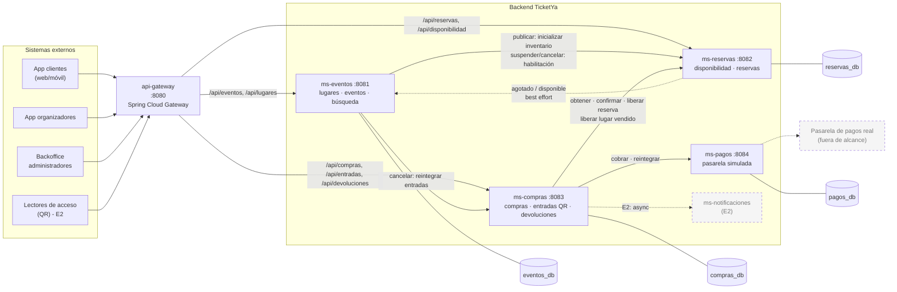
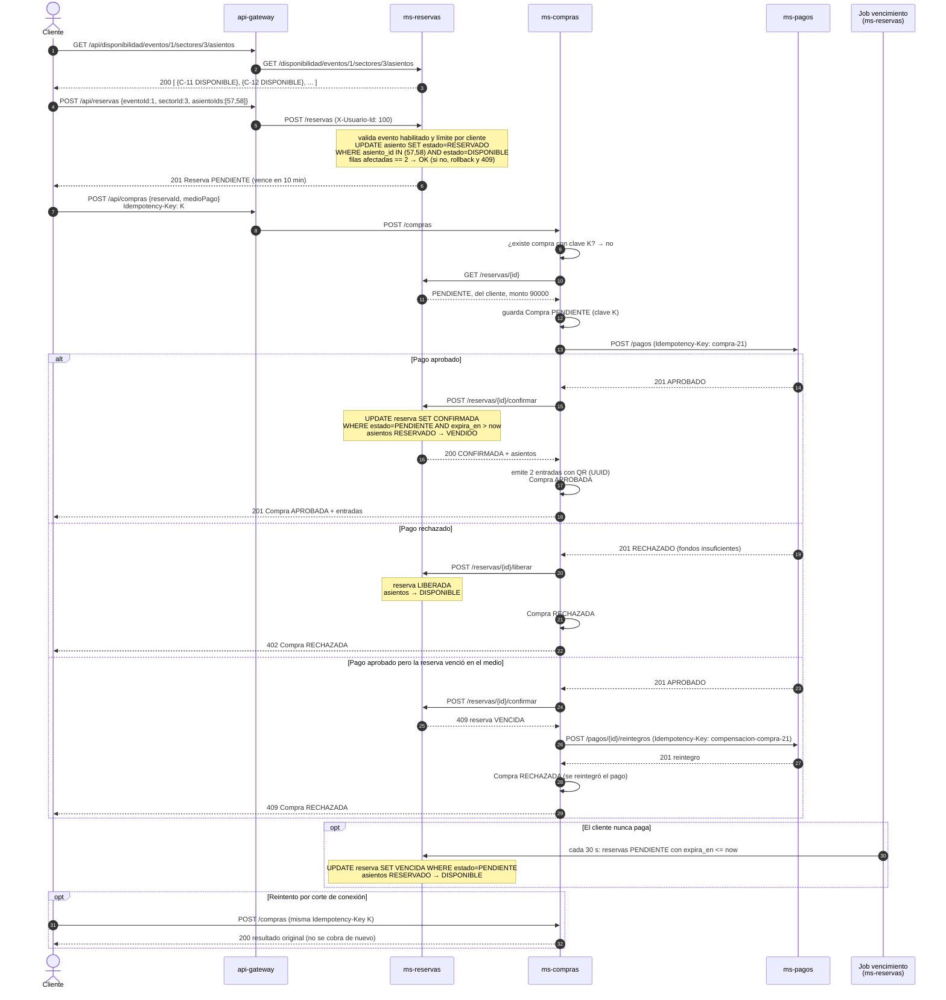

# Arquitectura de microservicios

## 1. Visión general

El backend se divide en 4 microservicios Spring Boot + un API Gateway. Cada microservicio es un proyecto Maven
independiente, con su propia base de datos PostgreSQL (mismo motor, bases separadas) y se puede construir y
ejecutar por separado. Los clientes externos (apps de clientes y organizadores, backoffice, lectores de acceso)
entran siempre por el gateway.

| Servicio | Puerto | Base | Responsabilidad |
|---|---|---|---|
| `api-gateway` | 8080 | – | Punto de entrada único. Ruteo por prefijo `/api/...`, bloqueo de endpoints internos, log de cada request (endpoint, usuario, status, tiempo) y `X-Correlation-Id`. Swagger UI unificado. |
| `ms-eventos` | 8081 | `eventos_db` | Catálogo: lugares, sectores y asientos; eventos y su ciclo de vida (borrador, publicación, suspensión, cancelación); precios por sector; búsqueda por múltiples criterios. |
| `ms-reservas` | 8082 | `reservas_db` | Inventario de lugares por evento (estado de cada asiento y cupo de cada zona), reservas temporales con vencimiento, límite por cliente. **Responsable de que no haya doble venta.** |
| `ms-compras` | 8083 | `compras_db` | Orquesta la compra (reserva → pago → confirmación), emite las entradas con QR, devoluciones y reintegros por cancelación. |
| `ms-pagos` | 8084 | `pagos_db` | Pasarela de pagos **simulada** (mock): cobros y reintegros idempotentes. Representa al sistema externo de pagos. |

### ¿Por qué esta división?

- **Separar catálogo de inventario.** El catálogo (`ms-eventos`) se lee muchísimo y cambia poco: es candidato a
  cache (entrega 2). El inventario (`ms-reservas`) cambia todo el tiempo durante una venta masiva y es donde está
  la contención. Si estuvieran juntos no podríamos escalarlos ni cachearlos por separado.
- **`ms-reservas` no depende de nadie en el camino crítico.** Al publicar un evento, `ms-eventos` le copia lo que
  necesita (sectores, precios, asientos, fecha, límite por cliente). Así una reserva se resuelve con una sola
  base de datos, sin llamadas remotas, que es lo que más importa en la apertura de venta.
- **`ms-compras` como orquestador.** La compra involucra tres servicios. Concentrar la coordinación en uno solo
  hace más fácil razonar los fallos parciales y las compensaciones.
- **`ms-pagos` aislado** porque en la realidad es un sistema externo; tenerlo detrás de su propia API permite
  reemplazar el mock por la pasarela real sin tocar `ms-compras`.
- Los **usuarios** no tienen servicio propio en la entrega 1 (no hay autenticación: el usuario viaja en los
  headers `X-Usuario-Id` y `X-Rol`). En la entrega 2 se agrega `ms-usuarios` con JWT.

## 2. Diagrama de módulos



Todas las flechas son **llamadas REST síncronas** (con `RestClient` y timeouts de 2-3 s). Las punteadas son
avisos *best effort* o componentes de la entrega 2.

### Estructura interna de cada microservicio

```
com.ticketya.<servicio>
├── controller   ← endpoints REST + anotaciones OpenAPI
├── service      ← reglas de negocio
├── repository   ← Spring Data JPA (incluye los UPDATE condicionales)
├── model        ← entidades JPA y enums
├── dto          ← records de request/response
├── client       ← clientes REST hacia otros servicios (interfaz + implementación)
├── exception    ← excepciones de negocio + GlobalExceptionHandler
└── config       ← beans (RestClient, Clock, OpenAPI)
```

Los clientes hacia otros servicios se definen como **interfaces** (`ReservasClient`, `PagosClient`, ...) para poder
mockearlos en los tests y, en la entrega 2, agregar resiliencia (reintentos, circuit breaker) sin tocar los services.

## 3. API pública de cada servicio

Resumen (el detalle con parámetros, códigos y ejemplos está en [04-api-rest.md](04-api-rest.md) y en
[openapi/](openapi/)). Las rutas públicas se acceden por el gateway con el prefijo `/api`.

| Servicio | Endpoints públicos | Endpoints internos (no expuestos por el gateway) |
|---|---|---|
| ms-eventos | `POST/GET /lugares`, `GET /lugares/{id}`, `GET /lugares/{id}/sectores/{sid}/asientos`, `GET/POST /eventos`, `GET/PUT /eventos/{id}`, `PUT /eventos/{id}/precios`, `POST /eventos/{id}/publicar\|suspender\|reanudar\|cancelar` | `POST /internal/eventos/{id}/agotado\|disponible` |
| ms-reservas | `GET /disponibilidad/eventos/{id}`, `GET /disponibilidad/eventos/{id}/sectores/{sid}/asientos`, `POST/GET /reservas`, `GET/DELETE /reservas/{id}` | `POST /disponibilidad/eventos/{id}`, `PATCH /disponibilidad/eventos/{id}/estado`, `POST /disponibilidad/eventos/{id}/liberaciones`, `POST /reservas/{id}/confirmar\|liberar` |
| ms-compras | `POST/GET /compras`, `GET /compras/{id}`, `GET /entradas`, `GET /entradas/{id}`, `GET /entradas/{id}/qr`, `POST /entradas/{id}/devolucion`, `GET /devoluciones`, `POST /devoluciones/{id}/aprobar\|rechazar` | `POST /internal/eventos/{id}/cancelacion` |
| ms-pagos | – (solo lo usa ms-compras) | `POST /pagos`, `GET /pagos/{id}`, `GET /pagos?compraId=`, `POST /pagos/{id}/reintegros` |

## 4. Flujo de compra de una entrada numerada

Incluye los tres finales posibles: pago aprobado, pago rechazado y reserva vencida.



Notas:
- Si `ms-pagos` o `ms-reservas` no responden (timeout), la compra queda en **ERROR** (503) y el cliente reintenta
  con la misma clave. Como la clave hacia la pasarela es siempre `compra-{id}`, el reintento no cobra dos veces.
- Si el pago se rechaza y falla la liberación de la reserva, no pasa nada grave: el job de vencimiento la libera
  a los 10 minutos.

## 5. Consistencia entre servicios (resumen)

No hay una transacción de base de datos que abarque a los tres servicios, así que:

- Cada servicio confirma sus cambios en **transacciones locales cortas** (`ms-compras` nunca mantiene una
  transacción abierta mientras espera una respuesta remota).
- Todas las operaciones entre servicios son **idempotentes** (por clave o por transición de estado condicional),
  así que ante la duda se pueden reintentar.
- Si un paso falla después de que otro ya se hizo, se **compensa**: pago aprobado + reserva no confirmable →
  reintegro.
- La consistencia es **fuerte dentro de `ms-reservas`** (que es lo que garantiza la no doble venta) y
  **eventual** para datos informativos (por ejemplo, el estado AGOTADO en `ms-eventos`).

La estrategia completa (saga, mensajería, reintentos automáticos) se documenta en la entrega 2.

## 6. Decisiones de diseño relevantes

| Tema | Decisión | Motivo |
|---|---|---|
| Doble venta | UPDATE condicional en la base + restricciones UNIQUE | Funciona con N instancias; ver [05-concurrencia-y-pruebas.md](05-concurrencia-y-pruebas.md). |
| Reintentos del cliente | `Idempotency-Key` en `POST /compras` y en las llamadas a pagos | Evita cobros duplicados por cortes de conexión. |
| Vencimiento de reservas | Job `@Scheduled` cada 30 s + chequeo de `expira_en` al confirmar | El job puede correr en todas las instancias a la vez sin problemas. |
| Endpoints internos | `/internal/**` o marcados `[Interno]`; el gateway los bloquea | Un cliente no puede confirmar una reserva sin pagar. |
| QR | UUID aleatorio por entrada (imagen PNG con ZXing) | No se puede adivinar a partir del id. |
| Datos de tarjeta | Solo se guardan los últimos 4 dígitos | Nunca guardar el número completo. |
| Trazabilidad | El gateway loguea cada request y agrega `X-Correlation-Id` | Base para el log centralizado de la entrega 2. |
| Cache | **No** se cachea la disponibilidad ni las reservas | Cambian en cada compra; un dato viejo haría ofrecer asientos ya vendidos. El catálogo y las búsquedas se cachean en la entrega 2. |
| Comunicación | REST síncrono en toda la entrega 1 | Lo pide la consigna para esta entrega; las notificaciones y la fila virtual serán asincrónicas. |
