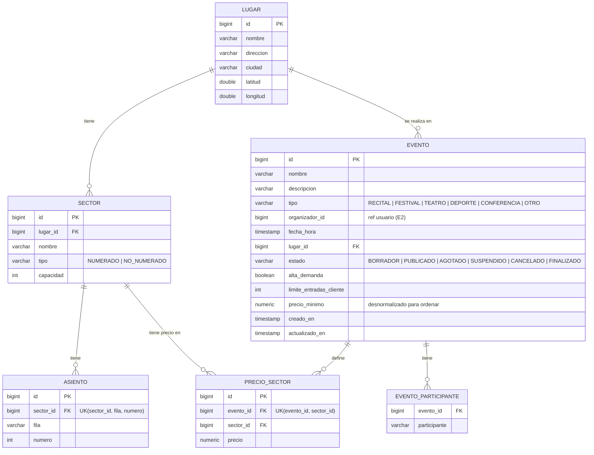
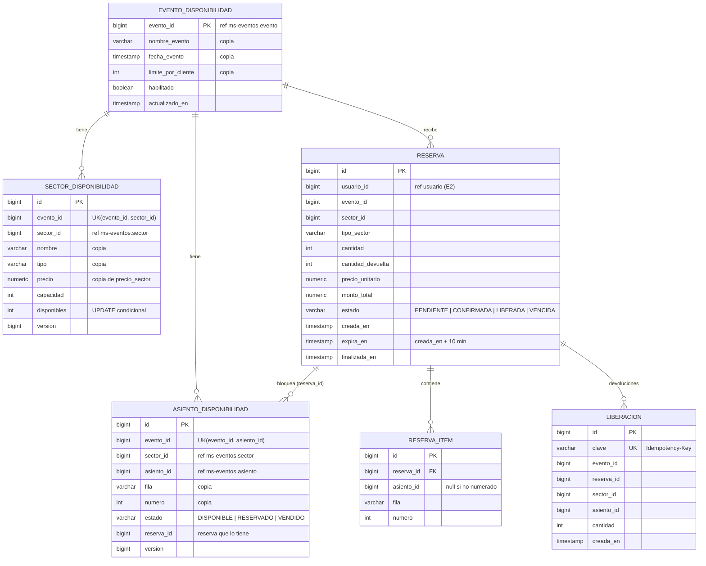
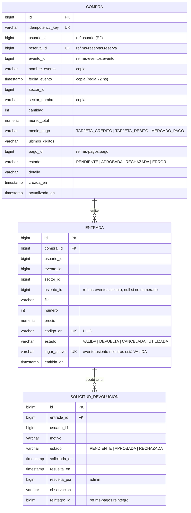
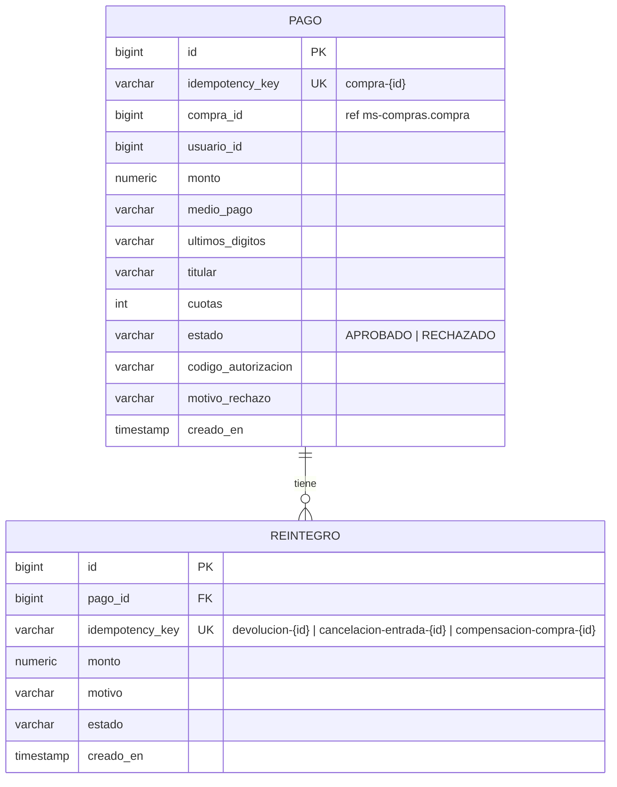
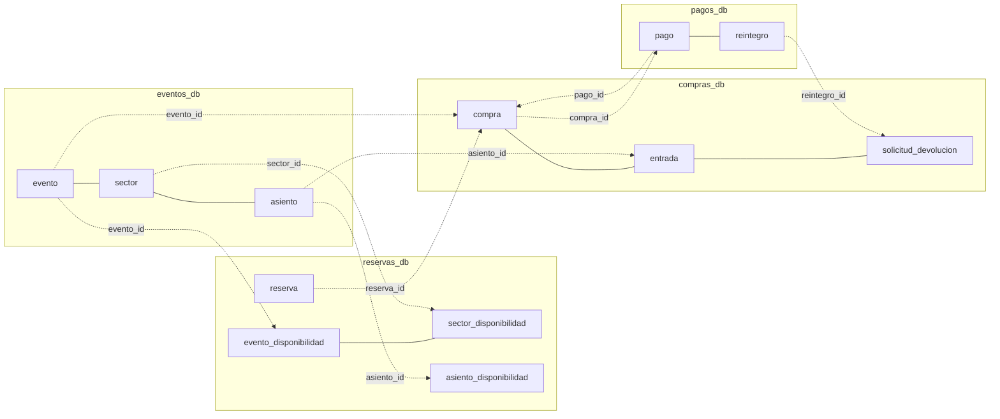

# Modelo de datos

Cada microservicio tiene su propia base PostgreSQL (`eventos_db`, `reservas_db`, `compras_db`, `pagos_db`).
**No hay claves foráneas entre bases**: las referencias a datos de otro servicio se guardan como un id
"lógico" (columna `*_id` sin FK) y, cuando hace falta, con una copia de los datos necesarios.

Convenciones de los diagramas: `PK` clave primaria, `FK` clave foránea dentro de la misma base, `UK` única,
y `"ref ms-x"` indica un id que apunta a una entidad de otro microservicio.

Las tablas las genera Hibernate (`ddl-auto: update`) a partir de las entidades JPA.

## ms-eventos (`eventos_db`)

## ms-reservas (`reservas_db`)

Índices adicionales: `asiento_disponibilidad(evento_id, sector_id)`, `asiento_disponibilidad(reserva_id)`,
`reserva(estado, expira_en)` (para el job de vencimiento) y `reserva(usuario_id, evento_id)` (límite por cliente).

## ms-compras (`compras_db`)

## ms-pagos (`pagos_db`)

## Relaciones entre servicios

| Referencia | Desde | Hacia | Cómo se mantiene |
|---|---|---|---|
| `evento_id` | reservas_db, compras_db | ms-eventos.evento | Se fija al publicar / comprar; el id nunca cambia. |
| `sector_id`, `asiento_id` | reservas_db, compras_db | ms-eventos.sector / asiento | Ídem. |
| `reserva_id` | compras_db.compra (UNIQUE) | ms-reservas.reserva | Una compra por reserva. |
| `compra_id` | pagos_db.pago | ms-compras.compra | Se manda al cobrar. |
| `pago_id`, `reintegro_id` | compras_db | ms-pagos | Se guardan con la respuesta de ms-pagos. |
| `usuario_id`, `organizador_id` | todas | (ms-usuarios, entrega 2) | Hoy viene del header `X-Usuario-Id`. |

## Entidades solapadas entre bases

Hay datos que aparecen en más de una base. Es una decisión consciente para que cada servicio sea autónomo
(sobre todo `ms-reservas`, que no debe depender de nadie durante una venta masiva).

| Concepto | Dueño (fuente de verdad) | Copia en | Qué se copia | Cuándo se sincroniza |
|---|---|---|---|---|
| Evento | ms-eventos `evento` | ms-reservas `evento_disponibilidad` | nombre, fecha, límite por cliente; estado como `habilitado` | Al publicar (alta) y al suspender/reanudar/cancelar (habilitado). |
| Evento | ms-eventos `evento` | ms-compras `compra` | nombre y fecha | Al comprar (snapshot). |
| Sector + precio | ms-eventos `sector`, `precio_sector` | ms-reservas `sector_disponibilidad` | nombre, tipo, precio, capacidad | Al publicar. Los precios no se pueden cambiar después de publicar, así que la copia no queda desactualizada. |
| Asiento | ms-eventos `asiento` | ms-reservas `asiento_disponibilidad` | fila y número (+ estado propio) | Al publicar. |
| Asiento vendido | ms-reservas `asiento_disponibilidad` (VENDIDO) | ms-compras `entrada` (`lugar_activo`) | evento + asiento | Al confirmar la compra / al devolver. |
| Pago | ms-pagos `pago` | ms-compras `compra` | id del pago, medio, últimos dígitos | Con la respuesta del cobro. |

Riesgos y cómo se manejan:
- Si se cambiara la fecha de un evento publicado, las copias quedarían viejas. Por eso en la entrega 1 solo se
  pueden modificar eventos en borrador; el cambio de evento publicado (con notificación) es de la entrega 2.
- El estado AGOTADO en `ms-eventos` es informativo y se actualiza *best effort*: la disponibilidad real siempre se
  consulta en `ms-reservas`.
