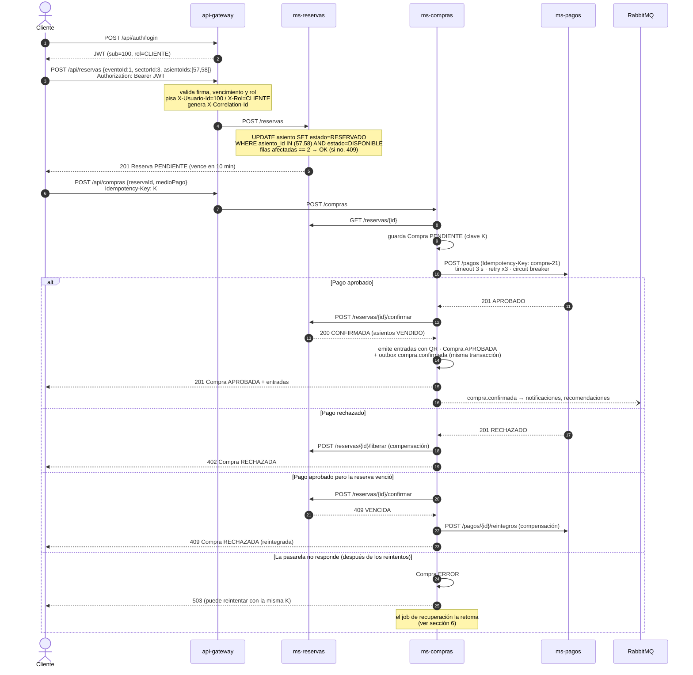
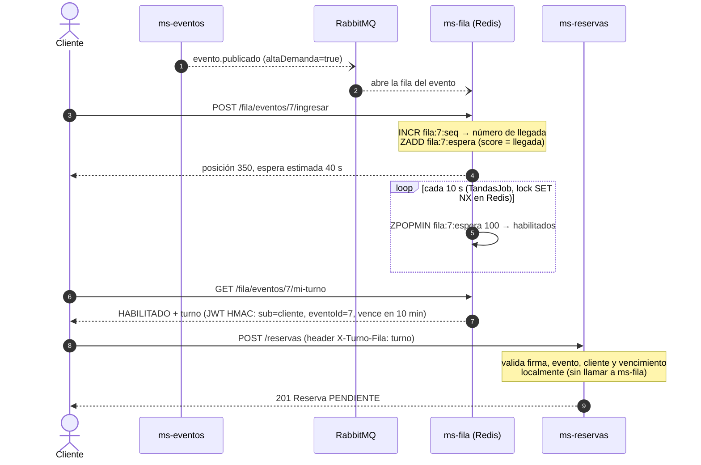
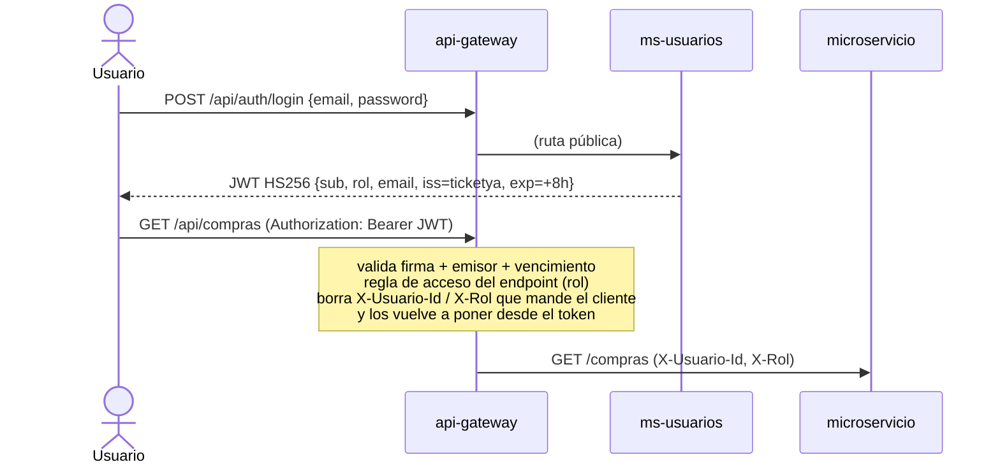

# Arquitectura de microservicios

> Actualizado para la **entrega 2**. Los cambios respecto de la entrega 1 se marcan con **(E2)**.

## 1. Visión general

El backend se divide en 9 microservicios Spring Boot + un API Gateway. Cada microservicio es un proyecto Maven
independiente, con su propia base de datos (bases separadas aunque compartan motor) y se puede construir y
ejecutar por separado. Los clientes externos (apps de clientes y organizadores, backoffice, lectores de acceso)
entran siempre por el gateway, que valida el JWT.

| Servicio | Puerto | Datos | Responsabilidad |
|---|---|---|---|
| `api-gateway` | 8080 | – | Punto de entrada único. **(E2)** Valida el JWT y aplica la matriz de roles por endpoint, pisa los headers de identidad, genera el `X-Correlation-Id`, loguea cada request. Bloquea los endpoints internos. Swagger UI unificado. |
| `ms-usuarios` **(E2)** | 8085 | PostgreSQL `usuarios_db` | Registro, login (emite el JWT), alta de usuarios con rol por un ADMIN, datos de contacto para notificaciones. |
| `ms-eventos` | 8081 | PostgreSQL `eventos_db` + **Redis (cache)** | Catálogo: lugares, sectores y asientos; eventos y su ciclo de vida; precios; búsqueda. **(E2)** Cache del catálogo, reprogramación de eventos y mensajes de dominio (outbox). |
| `ms-reservas` | 8082 | PostgreSQL `reservas_db` | Inventario por evento y reservas temporales. **Responsable de que no haya doble venta.** **(E2)** Valida el turno de la fila virtual. En docker-compose corre con **2 instancias**. |
| `ms-compras` | 8083 | PostgreSQL `compras_db` | Orquesta la compra (saga), emite las entradas con QR, devoluciones y cancelaciones. **(E2)** Control de acceso con QR, reportes para organizadores, recuperación de compras a medias, Resilience4j. |
| `ms-pagos` | 8084 | PostgreSQL `pagos_db` | Pasarela de pagos **simulada**: cobros y reintegros idempotentes. **(E2)** Fallas simuladas configurables (503). |
| `ms-fila` **(E2)** | 8086 | **Redis** | Fila virtual para eventos de alta demanda: orden de llegada, tandas, turnos firmados. |
| `ms-recomendaciones` **(E2)** | 8087 | **MongoDB** `recomendaciones_db` | Preferencias de los clientes, historial de compras y recomendaciones. |
| `ms-notificaciones` **(E2)** | 8088 | **MongoDB** `notificaciones_db` | Emails de compra confirmada, cancelación, cambio de fecha y artista favorito (proveedor simulado). |
| `ms-bitacora` **(E2)** | 8089 | **MongoDB** `bitacora_db` | Log centralizado de operaciones críticas, consultable por `correlationId`. |

Infraestructura compartida **(E2)**: PostgreSQL 16, MongoDB 7, Redis 7 y RabbitMQ 3.13 (cada una en su contenedor).

### ¿Por qué esta división?

- **Separar catálogo de inventario.** El catálogo (`ms-eventos`) se lee muchísimo y cambia poco: se cachea en
  Redis. El inventario (`ms-reservas`) cambia todo el tiempo durante una venta masiva y es donde está la
  contención. Juntos no se podrían escalar ni cachear por separado.
- **`ms-reservas` no depende de nadie en el camino crítico.** Al publicar un evento, `ms-eventos` le copia lo que
  necesita. Una reserva se resuelve con una sola base, sin llamadas remotas. **(E2)** Incluso el turno de la fila
  se valida localmente (firma HMAC), sin llamar a `ms-fila`.
- **`ms-compras` como orquestador de la saga.** La compra involucra tres servicios; concentrar la coordinación en
  uno solo hace más fácil razonar los fallos parciales y las compensaciones.
- **`ms-pagos` aislado** porque en la realidad es un sistema externo.
- **(E2) `ms-fila` separado de `ms-reservas`**: la fila recibe el pico de tráfico de la apertura (miles de
  clientes consultando su posición cada pocos segundos). Así ese tráfico pega en Redis y no en la base de
  reservas, y se puede escalar por separado.
- **(E2) Servicios "satélite" asincrónicos** (`ms-recomendaciones`, `ms-notificaciones`, `ms-bitacora`): no están
  en el camino crítico de la compra. Se alimentan de mensajes de RabbitMQ, así si se caen la venta sigue.
- **(E2) Control de acceso y reportes en `ms-compras`**: los dos trabajan sobre las entradas, que son de
  `ms-compras`. Separarlos implicaría copiar las entradas a otra base (y sincronizarlas) sin una ganancia clara.
  La validación del QR necesita consistencia fuerte (un QR no puede entrar dos veces), que es más simple con un
  UPDATE condicional sobre la misma tabla.

## 2. Diagrama de módulos

```mermaid
flowchart LR
    subgraph Externos["Clientes externos"]
        APP["App clientes"]
        ORG["App organizadores"]
        BO["Backoffice admin"]
        LECT["Lectores QR"]
    end

    GW["api-gateway :8080<br/>JWT + roles · correlation id"]

    subgraph Sincronico["Camino crítico (REST)"]
        US["ms-usuarios :8085<br/>login · JWT"]
        EV["ms-eventos :8081<br/>catálogo · búsqueda"]
        RE["ms-reservas :8082 (x2)<br/>disponibilidad · reservas"]
        CO["ms-compras :8083<br/>saga compra · QR · acceso · reportes"]
        PA["ms-pagos :8084<br/>pasarela simulada"]
        FI["ms-fila :8086<br/>fila virtual"]
    end

    MQ{{"RabbitMQ<br/>ticketya.eventos<br/>ticketya.bitacora"}}

    subgraph Asincronico["Servicios asincrónicos"]
        RC["ms-recomendaciones :8087"]
        NO["ms-notificaciones :8088"]
        BI["ms-bitacora :8089"]
    end

    PG[("PostgreSQL<br/>usuarios · eventos · reservas<br/>compras · pagos")]
    RD[("Redis<br/>cache catálogo · fila")]
    MG[("MongoDB<br/>recomendaciones · notificaciones<br/>bitácora")]

    APP & ORG & BO & LECT --> GW
    GW --> US & EV & RE & CO & FI & RC & NO & BI

    EV -->|publicar / reprogramar / suspender| RE
    EV -->|cancelar: reintegros| CO
    RE -.->|agotado / disponible| EV
    CO -->|obtener · confirmar · liberar| RE
    CO -->|cobrar · reintegrar · consultar| PA
    CO -->|organizador del evento| EV

    EV ==>|evento.publicado / cancelado / reprogramado<br/>(outbox)| MQ
    CO ==>|compra.confirmada (outbox)| MQ
    MQ ==> FI & RC & NO & CO
    EV & RE & CO & PA -.->|operaciones críticas| MQ
    MQ -.-> BI

    NO -->|contacto| US
    NO -->|compradores| CO
    NO -->|interesados| RC

    US & EV & RE & CO & PA --- PG
    EV & FI --- RD
    RC & NO & BI --- MG
```

- Flechas simples: **REST síncrono** (`RestClient` con timeouts de 2-3 s y Resilience4j donde corresponde).
- Flechas dobles: **mensajes de dominio** por RabbitMQ (exchange topic `ticketya.eventos`).
- Punteadas: avisos *best effort* (estado agotado) y registros de bitácora (exchange `ticketya.bitacora`).

### Estructura interna de cada microservicio

```
com.ticketya.<servicio>
├── controller    ← endpoints REST + anotaciones OpenAPI
├── service       ← reglas de negocio (y jobs @Scheduled)
├── repository    ← Spring Data JPA / MongoDB (incluye los UPDATE condicionales)
├── model         ← entidades / documentos y enums
├── dto           ← records de request/response
├── client        ← clientes REST hacia otros servicios (interfaz + implementación con Resilience4j)
├── mensajeria    ← (E2) outbox, publicador y listeners de RabbitMQ, contratos de mensajes
├── trazabilidad  ← (E2) CorrelacionFilter (log de requests + MDC), interceptor REST, Bitacora
├── exception     ← excepciones de negocio + GlobalExceptionHandler
└── config        ← beans (RestClient, Clock, OpenAPI, cache, RabbitMQ)
```

## 3. API pública de cada servicio

El detalle con parámetros, códigos, roles y ejemplos está en [04-api-rest.md](04-api-rest.md) y en
[openapi/](openapi/). Las rutas públicas se acceden por el gateway con el prefijo `/api`.

| Servicio | Endpoints expuestos por el gateway | Endpoints internos (el gateway devuelve 404) |
|---|---|---|
| ms-usuarios | `POST /auth/registro`, `POST /auth/login`, `GET /usuarios/me`, `GET/POST /usuarios`, `POST /usuarios/{id}/deshabilitar` | `GET /internal/usuarios/{id}` |
| ms-eventos | `POST/GET /lugares`, `GET /lugares/{id}`, `GET /lugares/{id}/sectores/{sid}/asientos`, `GET/POST /eventos`, `GET/PUT /eventos/{id}`, `PUT /eventos/{id}/precios`, `POST /eventos/{id}/publicar\|reprogramar\|suspender\|reanudar\|cancelar` | `POST /internal/eventos/{id}/agotado\|disponible` |
| ms-reservas | `GET /disponibilidad/eventos/{id}`, `GET /disponibilidad/eventos/{id}/sectores/{sid}/asientos`, `POST/GET /reservas`, `GET/DELETE /reservas/{id}` | `POST /disponibilidad/eventos/{id}`, `PATCH /disponibilidad/eventos/{id}/estado\|fecha`, `POST /disponibilidad/eventos/{id}/liberaciones`, `POST /reservas/{id}/confirmar\|liberar` |
| ms-compras | `POST/GET /compras`, `GET /compras/{id}`, `GET /entradas`, `GET /entradas/{id}`, `GET /entradas/{id}/qr`, `POST /entradas/{id}/devolucion`, `GET /devoluciones`, `POST /devoluciones/{id}/aprobar\|rechazar`, `POST /accesos/validar`, `GET /accesos/eventos/{id}`, `GET /reportes/eventos/{id}` | `POST /internal/eventos/{id}/cancelacion`, `GET /internal/eventos/{id}/compradores` |
| ms-pagos | – (solo lo usa ms-compras) | `POST /pagos`, `GET /pagos/{id}`, `GET /pagos?compraId=`, `POST /pagos/{id}/reintegros` |
| ms-fila | `POST /fila/eventos/{id}/ingresar`, `GET /fila/eventos/{id}/mi-turno`, `DELETE /fila/eventos/{id}`, `GET /fila/eventos/{id}/estado`, `PUT /fila/eventos/{id}/configuracion` | – |
| ms-recomendaciones | `GET/PUT /preferencias`, `GET /recomendaciones`, `GET /recomendaciones/eventos/{id}/tambien-compraron` | `GET /internal/preferencias/interesados` |
| ms-notificaciones | `GET /notificaciones` | – |
| ms-bitacora | `GET /bitacora`, `GET /bitacora/trazas/{correlationId}` | – |

## 4. Comunicación asincrónica (E2)

La consigna pide REST mayormente síncrono y mensajería donde se justifique. Se usa RabbitMQ en tres casos:

| Caso | Por qué asincrónico |
|---|---|
| Notificaciones | El cliente no tiene que esperar a que salga un email para ver su compra aprobada, y si el proveedor de email se cae la compra no puede fallar. |
| Read models (recomendaciones, fila, fecha del evento en compras) | Los servicios que reaccionan a un evento de dominio no tienen que estar disponibles en el momento en que ocurre; procesan el mensaje cuando pueden. |
| Bitácora centralizada | Registrar una operación no puede agregar latencia ni hacer fallar la operación (fire-and-forget). |

El camino crítico (reservar, pagar, confirmar) sigue siendo **REST síncrono**, porque el cliente necesita la
respuesta (¿se aprobó o no?) en el momento.

### Contratos de mensajes (exchange topic `ticketya.eventos`)

| Routing key | Emisor | Contenido | Consumidores (cola) |
|---|---|---|---|
| `evento.publicado` | ms-eventos | eventoId, nombre, tipo, organizadorId, participantes, lugar, ciudad, fechaHora, altaDemanda, precioMinimo | ms-fila (`fila.evento-publicado`: abre la fila si es de alta demanda), ms-recomendaciones (`recomendaciones.evento-publicado`: catálogo), ms-notificaciones (`notificaciones.evento-publicado`: avisa a los interesados) |
| `evento.cancelado` | ms-eventos | eventoId, nombre, motivo | ms-fila (cierra la fila), ms-recomendaciones (deja de sugerirlo), ms-notificaciones (avisa a los compradores) |
| `evento.reprogramado` | ms-eventos | eventoId, nombre, fechaAnterior, fechaNueva, motivo | ms-compras (`compras.evento-reprogramado`: nueva fecha para el plazo de devolución), ms-recomendaciones, ms-notificaciones |
| `compra.confirmada` | ms-compras | compraId, usuarioId, eventoId, nombreEvento, fechaEvento, sector, cantidad, montoTotal | ms-recomendaciones (historial), ms-notificaciones (email) |

Exchange topic `ticketya.bitacora`: la routing key es el nombre de la operación (`compra.aprobada`,
`pago.cobro`, `acceso.validado`, ...) y `ms-bitacora` consume todo (`#`) en la cola `bitacora.registros`.

Reglas comunes:
- **Outbox transaccional**: ms-eventos y ms-compras no publican directo. Guardan el mensaje en la tabla
  `mensaje_saliente` **en la misma transacción** que el cambio de negocio, y un job lo publica cada 1 s. Así no
  puede pasar que se cancele el evento y el mensaje se pierda (o que se mande el mensaje y la transacción haga
  rollback).
- **Entrega "al menos una vez"** → todos los consumidores son **idempotentes** (ej.: el historial usa el id de la
  compra como `_id`; las notificaciones tienen una clave única tipo+referencia+usuario).
- Cada tipo de mensaje tiene su cola; si un mensaje falla 3 veces va a una **DLQ** (`<cola>.dlq`) para revisarlo.
- El `X-Correlation-Id` viaja como header del mensaje, así los logs del consumidor quedan con el mismo id.

## 5. Flujo de compra de una entrada numerada

Incluye los finales posibles: pago aprobado, pago rechazado, reserva vencida y pasarela caída.



### Fila virtual (eventos de alta demanda)



## 6. Consistencia entre servicios y compensaciones (E2)

No hay una transacción que abarque a varios servicios (cada uno tiene su base), así que se combina
**consistencia fuerte** donde un error cuesta plata o lugares, y **consistencia eventual** donde un retraso de
milisegundos no le hace daño a nadie.

| Dato / operación | Tipo | Cómo se logra |
|---|---|---|
| Disponibilidad de asientos y cupos (no doble venta) | **Fuerte** | Todo dentro de `reservas_db`: UPDATE condicional + UNIQUE. Una sola base es la fuente de verdad, sin cache. |
| Uso de un QR en el ingreso | **Fuerte** | UPDATE condicional `VALIDA → UTILIZADA` en `compras_db`. |
| Cobro de una compra (no cobrar dos veces) | **Fuerte** (idempotencia) | `Idempotency-Key` del cliente + clave `compra-{id}` hacia la pasarela + UNIQUE en `pago.idempotency_key`. |
| Compra ↔ reserva ↔ pago | **Eventual con compensación (saga)** | Saga orquestada por ms-compras (abajo). En algún instante puede haber un pago aprobado con la compra en ERROR; el job lo resuelve. |
| Estado AGOTADO / DISPONIBLE en ms-eventos | Eventual | Aviso best effort de ms-reservas. Si se pierde, igual ms-reservas no vende de más. |
| Catálogo en cache | Eventual (acotada) | Invalidación al cambiar + TTL (10 min detalle, 60 s búsquedas). |
| Recomendaciones, historial, catálogo de ms-recomendaciones | Eventual | Mensajes de dominio (outbox + RabbitMQ). |
| Notificaciones | Eventual | Mensajes + reintentos; el email puede salir unos segundos después. |
| Fecha del evento en ms-compras (plazo de devolución) | Eventual | `evento.reprogramado`. |
| Bitácora | Eventual (best effort) | Fire-and-forget; si RabbitMQ no está, queda en el log local. |

### Saga orquestada de la compra

`ms-compras` coordina los pasos y, si uno falla después de que otro ya se hizo, ejecuta la **compensación**:

| Paso | Si falla... | Compensación |
|---|---|---|
| 1. Validar reserva (ms-reservas) | 4xx: no es del cliente / no está pendiente | No hay nada que deshacer: compra RECHAZADA. |
| 2. Cobrar (ms-pagos) | Pago rechazado | Liberar la reserva (`/reservas/{id}/liberar`). Si la liberación falla, la reserva vence sola a los 10 min. |
| 2. Cobrar (ms-pagos) | Timeout / 503 después de 3 intentos | Compra en **ERROR**; el cliente puede reintentar con la misma clave (no cobra doble) o la retoma el job. |
| 3. Confirmar reserva (ms-reservas) | 409: la reserva venció en el medio | **Reintegrar el pago** (`/pagos/{id}/reintegros`, clave `compensacion-compra-{id}`). |
| 3. Confirmar reserva (ms-reservas) | Timeout / 503 | Compra en ERROR (el pago quedó aprobado); la retoma el job. |
| 4. Emitir entradas + outbox (local) | – | Es una transacción local: o se emiten las entradas y el mensaje, o nada. |

**Job de recuperación** (`RecuperacionComprasJob`, cada 30 s, para compras en ERROR hace más de 60 s):
1. "Reclama" la compra con un UPDATE condicional `ERROR → PENDIENTE` (si corre en varias instancias, o el cliente
   reintenta justo, la toma uno solo).
2. Le pregunta a la pasarela qué pasó con el cobro de esa compra (`GET /pagos?compraId=`):
   - no hay pago o fue rechazado → libera la reserva y la compra queda RECHAZADA (nunca se cobró);
   - pago aprobado → intenta confirmar la reserva y emitir las entradas; si la reserva ya venció, reintegra;
   - la pasarela sigue caída → la compra vuelve a ERROR y se reintenta en la próxima vuelta.

Esto se probó en `RecuperacionComprasTest` y en la prueba de carga con 20 % de fallas en la pasarela
([07-prueba-de-carga.md](07-prueba-de-carga.md)): al terminar, cada compra aprobada tenía exactamente un pago
aprobado y ninguna compra rechazada tenía cobros.

### Otras compensaciones

| Operación | Compensación / reintento |
|---|---|
| Cancelar un evento (ms-eventos → ms-compras) | ms-compras pasa las entradas a CANCELADA y pide un reintegro por cada una con clave `cancelacion-entrada-{id}`. Si la pasarela falla, la cancelación se puede repetir (idempotente) y solo reintegra lo que falta. |
| Aprobar una devolución | Si falla el reintegro, la solicitud sigue PENDIENTE y se puede volver a aprobar sin duplicar el reintegro. |
| Publicar un evento (ms-eventos → ms-reservas) | Si ms-reservas no responde, el evento sigue en BORRADOR (no se publica a medias). |
| Notificación que no se pudo enviar | Queda PENDIENTE y se reintenta con espera creciente (hasta 5 veces). |
| Mensaje que falla al procesarse | RabbitMQ lo reintenta 3 veces; después va a la DLQ. |

## 7. Resiliencia (E2)

Se usa **Resilience4j** (anotaciones `@Retry` y `@CircuitBreaker` en las implementaciones de los clientes, así los
services no cambian). Solo se reintentan fallas de comunicación (timeout, conexión rechazada, 5xx); las 4xx son
respuestas de negocio y no se reintentan.

| Llamada | Timeout | Retry | Circuit breaker | Fallback |
|---|---|---|---|---|
| ms-compras → ms-pagos | 3 s | 3 intentos, 200 ms con backoff x2, **misma Idempotency-Key** | ventana 50 llamadas, abre con 50 % de fallas, 10 s abierto | 503 al cliente y compra en ERROR (la retoma el job). Con el circuito abierto se falla rápido, sin reintentar. |
| ms-compras → ms-reservas | 3 s | 3 intentos (todas las operaciones son idempotentes) | – | ERROR / compensación según el paso. |
| ms-compras → ms-eventos (reportes) | 3 s | 2 intentos | sí | Último valor conocido del evento (en memoria). |
| ms-compras → ms-reservas (reportes) | 3 s | 3 intentos | – | El reporte sale sin la ocupación (`ocupacionDisponible: false`). |
| ms-notificaciones → proveedor de email | – | 3 intentos | sí | La notificación queda PENDIENTE y la reintenta un job. |
| ms-notificaciones → usuarios / compras / recomendaciones | 2 s | 3 intentos con backoff | sí (recomendaciones) | Excepción → RabbitMQ reintenta el mensaje y después DLQ. |
| ms-eventos → Redis (cache) | – | – | – | `CacheErrorHandler`: si Redis se cae se sigue leyendo de PostgreSQL. |
| Cualquier servicio → RabbitMQ (bitácora) | – | – | – | Queda en el log local. |
| api-gateway → servicios | connect 2 s, respuesta 15 s | – | – | 504 / 503. |

## 8. Cache (E2)

| Qué | Dónde | TTL | Invalidación |
|---|---|---|---|
| Detalle de un evento (`GET /eventos/{id}`) | Redis (compartido por las instancias de ms-eventos), cache `eventos` | 10 min | Se borra la entrada en cada cambio del evento (editar, precios, publicar, reprogramar, suspender, cancelar, agotado). |
| Resultados de búsqueda | Redis, cache `busquedas` | 60 s | Se vacía entero ante cualquier cambio de un evento. |
| Lugares (detalle y listado por ciudad) | Redis, caches `lugares` y `lugares-ciudad` | 1 h | Los lugares no se modifican; el listado se vacía al crear un lugar. |

Las invalidaciones son *transaction aware* (se aplican después del commit). **No se cachean**: la disponibilidad
de asientos, las reservas, las compras ni la fila. Son los datos que cambian en cada compra; un dato viejo haría
ofrecer asientos ya vendidos o mostrar una posición equivocada. Ver [06-decisiones-tecnologicas.md](06-decisiones-tecnologicas.md).

## 9. Trazabilidad (E2)

- **Log de requests**: el gateway y cada servicio (`CorrelacionFilter`) escriben una línea `bitacora.http` por
  request con método, endpoint, usuario, rol, código de respuesta y tiempo en ms.
- **Correlation id**: el gateway genera `X-Correlation-Id` (o respeta el que viene), lo manda a los servicios, lo
  devuelve en la respuesta y queda en el MDC: todas las líneas de log incluyen `[servicio,correlationId]`. Se
  propaga en las llamadas REST (interceptor) y en los mensajes de RabbitMQ (header).
- **Log centralizado**: las operaciones críticas (`reserva.confirmada`, `pago.cobro`, `compra.aprobada`,
  `compra.rechazada`, `compra.compensada`, `devolucion.*`, `evento.cancelado`, `cancelacion.reintegros`,
  `acceso.validado`, ...) se publican en `ticketya.bitacora` y `ms-bitacora` las guarda en MongoDB.
  `GET /api/bitacora/trazas/{correlationId}` muestra la operación completa a través de los servicios.

## 10. Seguridad (E2)



- La autorización por rol se hace **en el gateway** (`ReglasDeAcceso`), en un solo lugar. Los servicios además
  validan las reglas de negocio que dependen del dueño (ej. un organizador solo edita *sus* eventos).
- Los microservicios no se publican fuera de la red de Docker: solo se llega a ellos a través del gateway.
- Contraseñas con BCrypt; la clave del JWT y la de la fila salen de variables de entorno (`JWT_SECRETO`, `FILA_SECRETO`).

## 11. Despliegue (E2)

Cada microservicio tiene su `Dockerfile` (multi-stage: compila con Maven y corre sobre `eclipse-temurin:21-jre`
con un usuario sin privilegios y healthcheck de actuator). `docker-compose.yml` levanta todo con un comando:
4 contenedores de infraestructura + 9 microservicios (ms-reservas con 2 réplicas) + el gateway, con
`depends_on: service_healthy` para respetar el orden de arranque. Solo el gateway publica su puerto (8080) para
los clientes; los puertos de las bases quedan publicados únicamente para desarrollo.

## 12. Decisiones de diseño relevantes

| Tema | Decisión | Motivo |
|---|---|---|
| Doble venta | UPDATE condicional en la base + restricciones UNIQUE | Funciona con N instancias (probado con 2 réplicas en compose); ver [05](05-concurrencia-y-pruebas.md). |
| Reintentos | `Idempotency-Key` en `POST /compras` y en todas las llamadas a pagos | Permite reintentar (cliente y Resilience4j) sin cobros duplicados. |
| Fallos parciales | Saga orquestada + job de recuperación | Ver sección 6. |
| Mensajes | Outbox transaccional + consumidores idempotentes + DLQ | No perder ni duplicar efectos. |
| Fila virtual | Redis (sorted set) + turno firmado validado localmente | Absorbe el pico de la apertura sin tocar la base de reservas. |
| QR | UUID aleatorio + UPDATE condicional al ingresar | No se puede adivinar ni usar dos veces. |
| Seguridad | JWT validado en el gateway, identidad en headers internos | Un solo punto de control; los servicios no dependen de la librería de seguridad. |
| NoSQL | MongoDB para preferencias/historial, notificaciones y bitácora | Ver [06](06-decisiones-tecnologicas.md). |
| Cache | Redis para el catálogo; **no** para la disponibilidad | Ver sección 8. |
