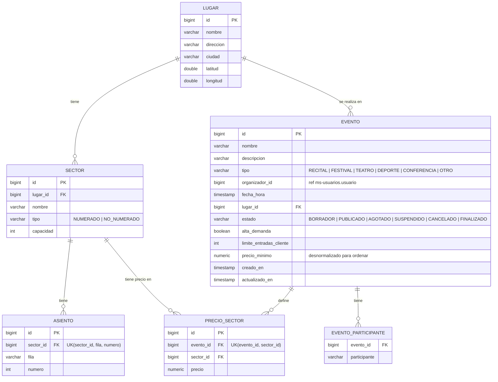
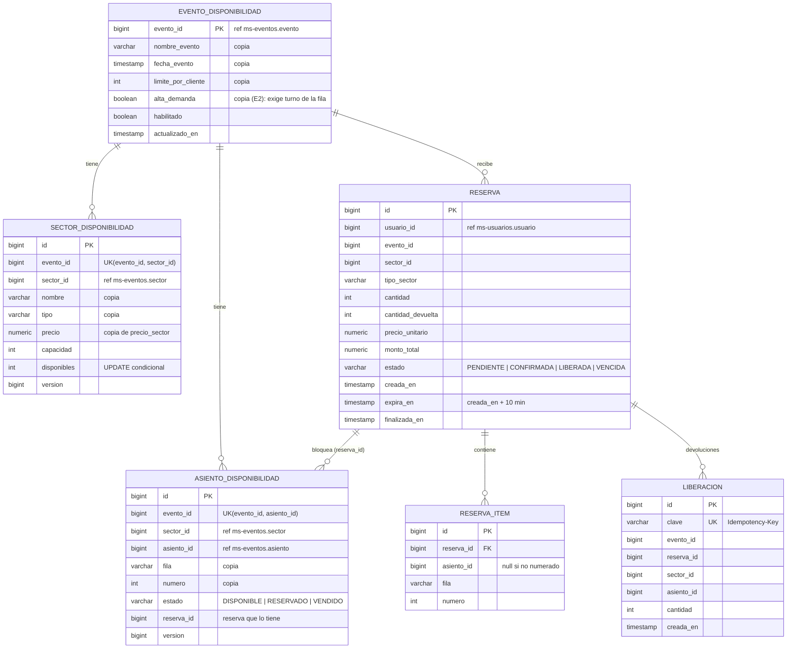
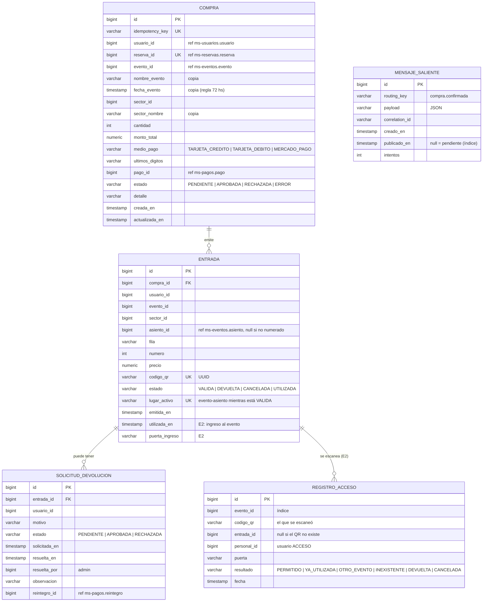
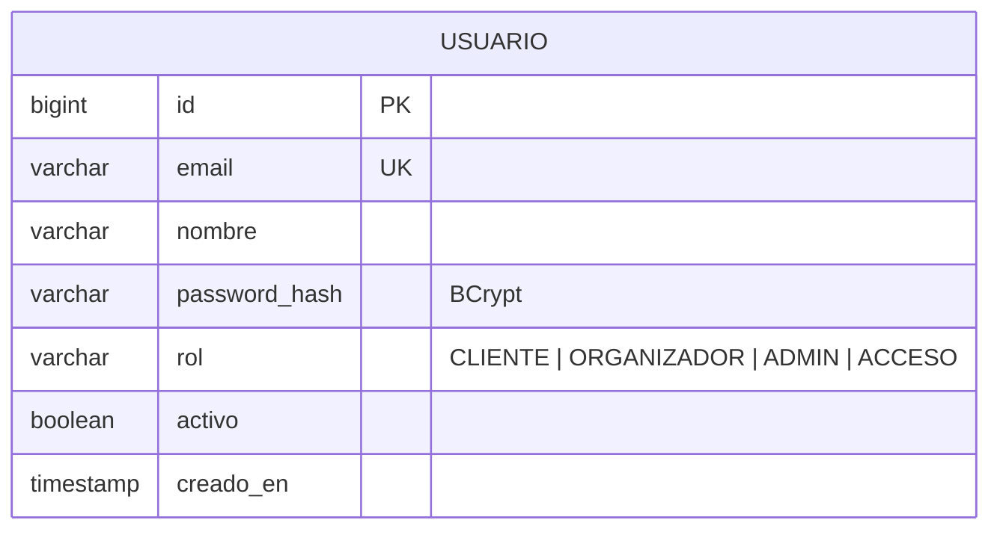
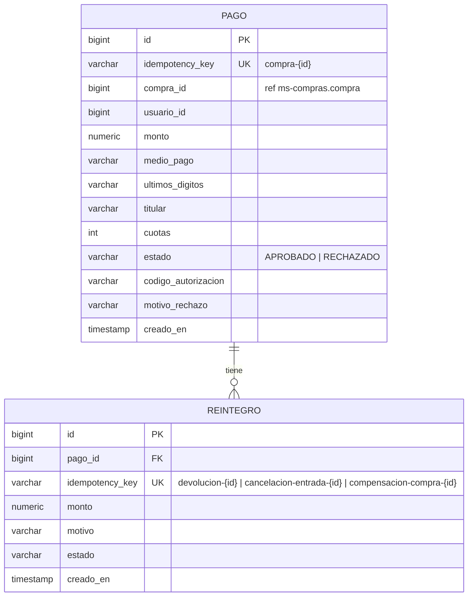
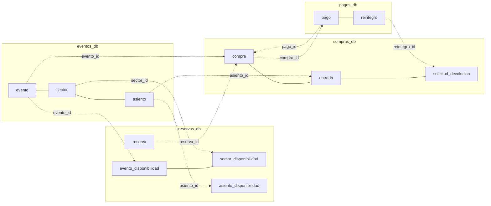
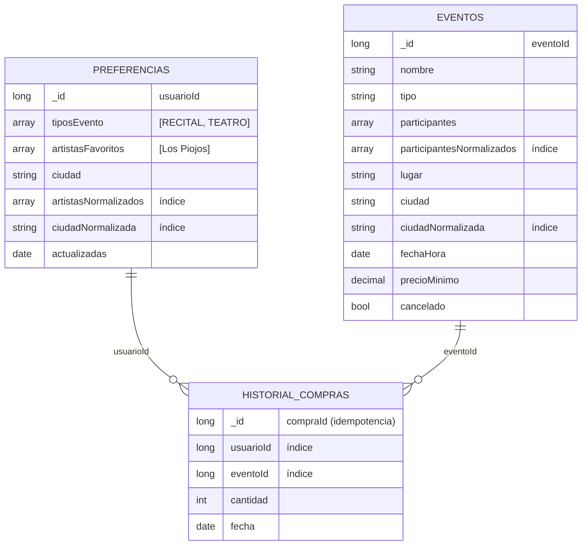
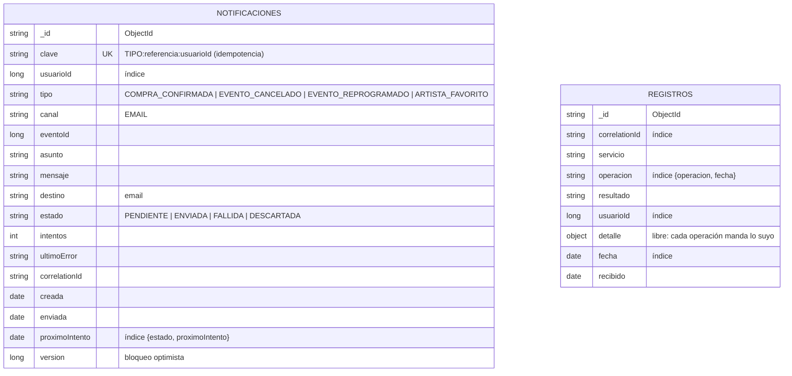

# Modelo de datos

Cada microservicio tiene su propia base. **(E2)** Hay tres tecnologías según el tipo de dato:

| Motor | Bases / uso | Servicios |
|---|---|---|
| PostgreSQL 16 | `usuarios_db`, `eventos_db`, `reservas_db`, `compras_db`, `pagos_db` (una base por servicio) | ms-usuarios, ms-eventos, ms-reservas, ms-compras, ms-pagos |
| MongoDB 7 | `recomendaciones_db`, `notificaciones_db`, `bitacora_db` | ms-recomendaciones, ms-notificaciones, ms-bitacora |
| Redis 7 | cache del catálogo (claves `ticketya:*`) y fila virtual (claves `fila:*`) | ms-eventos, ms-fila |

La justificación de cada elección está en [06-decisiones-tecnologicas.md](06-decisiones-tecnologicas.md).

**No hay claves foráneas entre bases**: las referencias a datos de otro servicio se guardan como un id
"lógico" (columna `*_id` sin FK) y, cuando hace falta, con una copia de los datos necesarios.

Convenciones de los diagramas: `PK` clave primaria, `FK` clave foránea dentro de la misma base, `UK` única,
y `"ref ms-x"` indica un id que apunta a una entidad de otro microservicio.

Las tablas las genera Hibernate (`ddl-auto: update`) a partir de las entidades JPA.

## ms-eventos (`eventos_db`)

**(E2) Outbox:** ms-eventos tiene además la tabla `mensaje_saliente` (misma estructura que en ms-compras) donde
se guardan los mensajes `evento.publicado`, `evento.cancelado` y `evento.reprogramado` en la misma transacción
que el cambio del evento.

## ms-reservas (`reservas_db`)

Índices adicionales: `asiento_disponibilidad(evento_id, sector_id)`, `asiento_disponibilidad(reserva_id)`,
`reserva(estado, expira_en)` (para el job de vencimiento) y `reserva(usuario_id, evento_id)` (límite por cliente).

## ms-compras (`compras_db`)

## ms-usuarios (`usuarios_db`) (E2)

Usuarios precargados para probar: ver README (admin, 2 organizadores, 2 clientes y personal de acceso).

## ms-pagos (`pagos_db`)

## Relaciones entre servicios

| Referencia | Desde | Hacia | Cómo se mantiene |
|---|---|---|---|
| `evento_id` | reservas_db, compras_db | ms-eventos.evento | Se fija al publicar / comprar; el id nunca cambia. |
| `sector_id`, `asiento_id` | reservas_db, compras_db | ms-eventos.sector / asiento | Ídem. |
| `reserva_id` | compras_db.compra (UNIQUE) | ms-reservas.reserva | Una compra por reserva. |
| `compra_id` | pagos_db.pago | ms-compras.compra | Se manda al cobrar. |
| `pago_id`, `reintegro_id` | compras_db | ms-pagos | Se guardan con la respuesta de ms-pagos. |
| `usuario_id`, `organizador_id`, `personal_id` | todas | ms-usuarios.usuario | Sale del `sub` del JWT (el gateway lo pasa en `X-Usuario-Id`). |
| `eventoId`, `usuarioId`, `compraId` | MongoDB (recomendaciones, notificaciones, bitácora) | ms-eventos / ms-usuarios / ms-compras | Llegan en los mensajes de RabbitMQ. |

## Entidades solapadas entre bases

Hay datos que aparecen en más de una base. Es una decisión consciente para que cada servicio sea autónomo
(sobre todo `ms-reservas`, que no debe depender de nadie durante una venta masiva).

| Concepto | Dueño (fuente de verdad) | Copia en | Qué se copia | Cuándo se sincroniza |
|---|---|---|---|---|
| Evento | ms-eventos `evento` | ms-reservas `evento_disponibilidad` | nombre, fecha, límite por cliente; estado como `habilitado` | Al publicar (alta) y al suspender/reanudar/cancelar (habilitado). |
| Evento | ms-eventos `evento` | ms-compras `compra` | nombre y fecha | Al comprar (snapshot). |
| Sector + precio | ms-eventos `sector`, `precio_sector` | ms-reservas `sector_disponibilidad` | nombre, tipo, precio, capacidad | Al publicar. Los precios no se pueden cambiar después de publicar, así que la copia no queda desactualizada. |
| Asiento | ms-eventos `asiento` | ms-reservas `asiento_disponibilidad` | fila y número (+ estado propio) | Al publicar. |
| Asiento vendido | ms-reservas `asiento_disponibilidad` (VENDIDO) | ms-compras `entrada` (`lugar_activo`) | evento + asiento | Al confirmar la compra / al devolver. |
| Pago | ms-pagos `pago` | ms-compras `compra` | id del pago, medio, últimos dígitos | Con la respuesta del cobro. |
| Fecha del evento (E2) | ms-eventos `evento` | ms-reservas, ms-compras, ms-recomendaciones | fecha y hora | Al reprogramar (REST a reservas, mensaje al resto). |
| Evento publicado (E2) | ms-eventos `evento` | ms-recomendaciones `eventos` | nombre, tipo, participantes, ciudad, fecha, precio mínimo, cancelado | Mensajes `evento.*`. |
| Compra confirmada (E2) | ms-compras `compra` | ms-recomendaciones `historial_compras` | compra, usuario, evento, cantidad | Mensaje `compra.confirmada`. |

Riesgos y cómo se manejan:
- **(E2)** La fecha de un evento publicado se puede cambiar con `POST /eventos/{id}/reprogramar`: ms-eventos
  actualiza la copia de ms-reservas en el momento (REST) y emite `evento.reprogramado`, con el que ms-compras
  actualiza `compra.fecha_evento` (plazo de 72 hs para devolver) y ms-recomendaciones su catálogo
  (consistencia eventual). El resto de los datos se sigue pudiendo modificar solo en borrador.
- El estado AGOTADO en `ms-eventos` es informativo y se actualiza *best effort*: la disponibilidad real siempre se
  consulta en `ms-reservas`.

## Datos NoSQL (E2)

### MongoDB

En MongoDB no hay un esquema fijo; estos son los documentos que guarda cada servicio y sus índices.

*`recomendaciones_db` (ms-recomendaciones).* Índice compuesto `{usuarioId, eventoId}` en el historial. La
recomendación "quienes compraron también compraron" es un *aggregation pipeline*:
`$match` (compradores del evento) → `$group` por `eventoId` con `$addToSet: usuarioId` → `$size` → `$sort`.

*`notificaciones_db` (ms-notificaciones)* guarda `notificaciones`; *`bitacora_db` (ms-bitacora)* guarda `registros`.

### Redis

| Clave | Tipo | Servicio | Contenido | Vida |
|---|---|---|---|---|
| `ticketya:eventos::{id}` | string (JSON) | ms-eventos | Detalle de un evento | TTL 10 min / se borra al cambiar |
| `ticketya:busquedas::{filtros}` | string (JSON) | ms-eventos | Página de resultados | TTL 60 s |
| `ticketya:lugares::{id}`, `ticketya:lugares-ciudad::{ciudad}` | string (JSON) | ms-eventos | Lugares | TTL 1 h |
| `fila:{evento}:config` | hash | ms-fila | organizador, tamaño de tanda, intervalo, minutos para comprar, activa | mientras dure la venta |
| `fila:{evento}:seq` | contador (`INCR`) | ms-fila | Número de llegada | ídem |
| `fila:{evento}:espera` | sorted set | ms-fila | clientes en espera, score = número de llegada | ídem |
| `fila:{evento}:habilitados` | contador | ms-fila | cuántos se habilitaron (para la posición estimada) | ídem |
| `fila:{evento}:hab:{usuario}` | string | ms-fila | cliente habilitado | TTL = minutos para comprar |
| `fila:{evento}:tanda` | string (`SET NX PX`) | ms-fila | lock: solo una instancia habilita cada tanda | TTL = intervalo |
